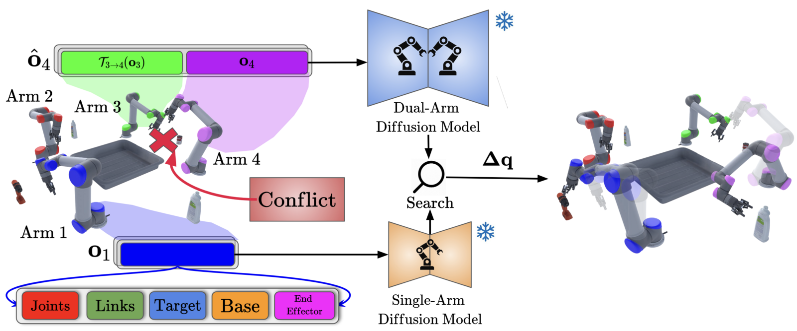

Collisions between arms are mostly pairwise, so DG-MAP plans with two diffusion models instead of learning the whole team's motion end to end. A single-arm model plans each arm on its own, and a dual-arm model repairs conflicts between pairs, the way MAPF planners split a team problem into single-agent searches plus collision resolution.

<figure class="page__lead-media">
  
  <figcaption>Each arm first plans on its own with a single-arm diffusion model. When two arms conflict, one of them uses a dual-arm diffusion model, conditioned on both arms' observations, to generate a collision-free motion.</figcaption>
</figure>

Trained only on single-arm and dual-arm data, it **keeps average success above 92% with up to eight arms** and **reaches 89% on a pick-and-place task** where arms move objects from the ground into a shared bin.

<figure class="page__lead-media">
  <video autoplay muted loop playsinline preload="metadata" poster="/images/highlights/dgmap_3to8.jpg" aria-label="DG-MAP on test tasks with three to eight arms">
    <source src="/images/highlights/dgmap_3to8.mp4" type="video/mp4">
  </video>
  <figcaption>DG-MAP on test tasks with three to eight arms (left to right, top to bottom).</figcaption>
</figure>
