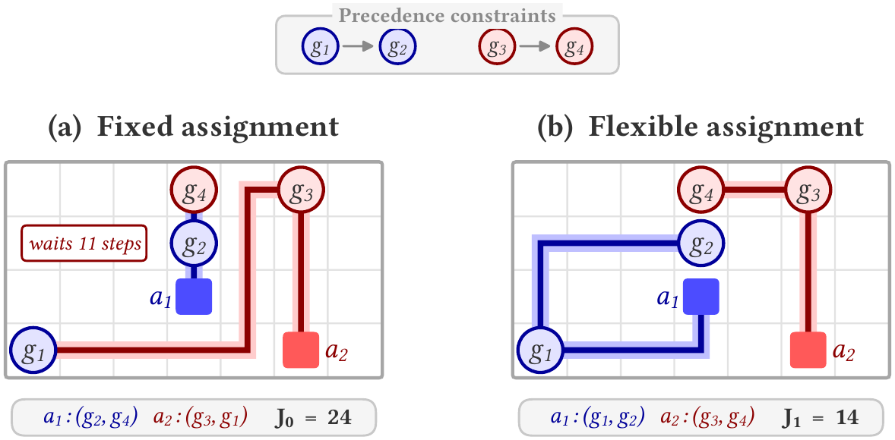

When task assignments are not fixed in advance, reassigning a task under precedence constraints changes both travel distances and when dependent tasks can begin. Precedence-Aware Coordination of Tasks (PACT) improves an initial fixed-assignment solution with large neighborhood search. Two precedence-aware operators, Precedence-Wait and Low-Slack, choose which tasks to reconsider, and each neighborhood is expanded to include all downstream tasks. Rather than replanning the whole team, PACT repairs only the affected robots with existing MAPF-PC solvers, so it can evaluate the routing and timing consequences of each reassignment before accepting it.

<figure class="page__lead-media">
  
  <figcaption>(a) With a fixed assignment, robot a1 must visit g2 then g4 and robot a2 must visit g3 then g1. Because g1 must come before g2, a1 waits 11 steps at g2, and the sum of costs is 24. (b) Giving each robot one precedence chain removes the wait and lowers the sum of costs to 14.</figcaption>
</figure>

With up to 500 robots and 1,600 tasks, PACT **improves 89.1% of fixed-assignment solutions** with **a median 12.3% reduction in the sum of costs**, while an LNS baseline with greedy regret-based repair achieves a median reduction of 0%.
