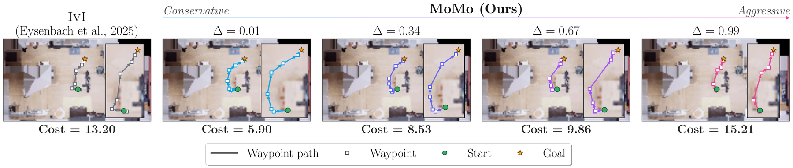
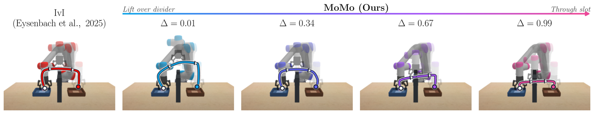

Contrastive representation learning can reduce long-horizon planning to inference in a low-dimensional linear system, but existing contrastive planners learn a single latent geometry and return one behavior for each start and goal. MoMo conditions both the representation geometry and the latent transition operator on a scalar preference, using Feature-Wise Linear Modulation for the encoder and low-rank modulation for the operator. A user can then shift plans between conservative and aggressive **at inference time without retraining**. The conditioning preserves the density ratio that contrastive planning relies on, so planning stays as efficient as before.

Across six environments with point, drone, quadruped and robot-arm agents, MoMo adapts plan safety smoothly to the preference and is more consistent over time and across preferences than baselines that append the preference to the state.

<figure class="page__lead-media">
  
  <figcaption>The same sweep for a quadruped Ant robot in an indoor scene from AI Habitat.</figcaption>
</figure>

<figure class="page__lead-media">
  
  <figcaption>The same sweep for a UR5 arm, from lifting over the divider to passing through the slot.</figcaption>
</figure>
