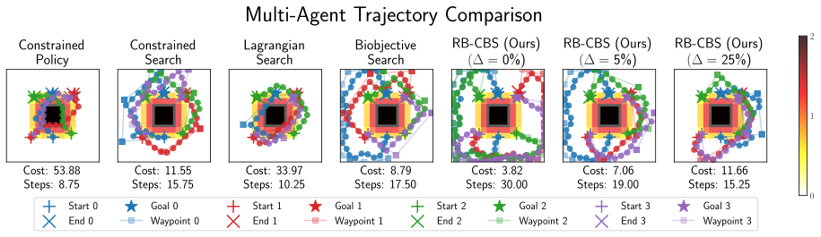

Earlier work on [safe visual navigation](/publication/2025-05-19-safe-multi-agent-navigation-guided-by-goal-conditioned-safe-reinforcement-learning-10) kept robots safe by deleting high-risk edges from the waypoint graph before planning, which rules out missions that must cross risky regions even when the total risk is acceptable. This work instead gives the team **one shared risk budget** and reallocates it between robots during conflict-based search, so robots can take shorter routes through hazardous areas whenever the total risk stays within the budget.

<figure class="page__lead-media">
  
  <figcaption>Paths from four baselines and from RB-CBS at global risk budgets Δ of 0%, 5% and 25%. As the budget grows, RB-CBS accepts more risk in exchange for shorter paths.</figcaption>
</figure>
