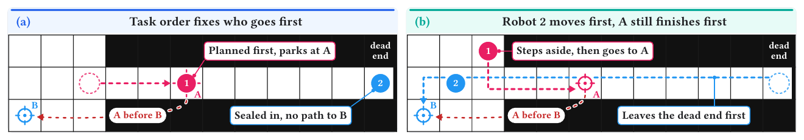
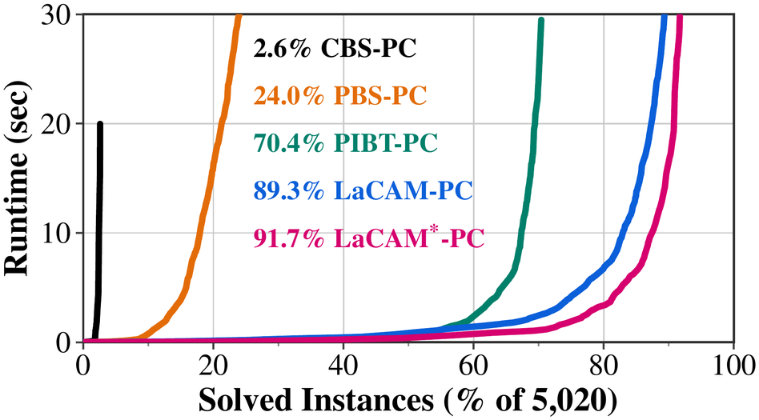

Existing solvers for MAPF with precedence constraints plan complete paths for individual robots and have been shown to handle only dozens (CBS-PC) or hundreds (PBS-PC) of robots. This work generates one joint move at a time while tracking both robot positions and task progress, and introduces precedence donation, which transfers priority from a robot waiting on an unfinished prerequisite to the robot responsible for completing it. PIBT-PC generates joint moves efficiently, LaCAM-PC embeds it in lazy configuration search for completeness, and LaCAM\*-PC adds anytime improvement and eventual optimality.

<figure class="page__lead-media">
  
  <figcaption>(a) When the precedence order decides which robot goes first, robot 1 is planned first and parks at A, which seals robot 2 in the dead end with no path to B. (b) Planning one joint move at a time lets robot 1 step aside so that robot 2 can leave the dead end first, and A is still completed before B.</figcaption>
</figure>

Across 5,020 instances on fourteen maps, LaCAM\*-PC **solves 91.7% of instances within 30 seconds**, compared with 24.0% for PBS-PC and 2.6% for CBS-PC, and the planners **scale to warehouse instances with 6,000 robots and 12,000 goals**.

<figure class="page__lead-media" style="max-width: 560px; margin-left: auto; margin-right: auto;">
  
  <figcaption>Runtime against the share of the 5,020 benchmark instances solved by each planner.</figcaption>
</figure>
