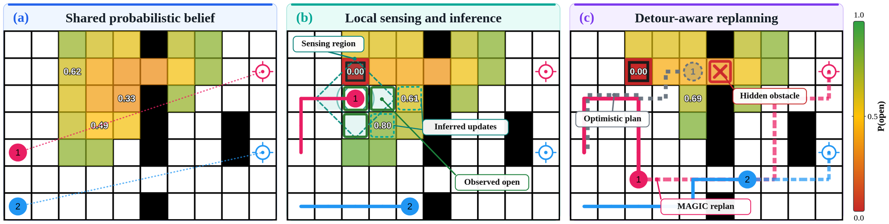

Multi-Agent Gaussian belief Inference for Coordination (MAGIC) maintains a shared belief about which uncertain locations are traversable, updating it whenever robots share new observations. A Gaussian Markov random field captures spatial dependencies, and Gaussian belief propagation updates the beliefs at locations no robot has observed yet. Each edge's cost combines its direct traversal cost and its shortest bypass, weighted by the estimated traversability, so existing planners such as CBS, PBS, PIBT, and LaCAM avoid likely blockages before the robots see them.

<figure class="page__lead-media">
  
  <figcaption>(a) The team shares a belief about which uncertain locations are open. (b) When an agent senses part of the map, MAGIC updates the belief at the observed locations and infers updates for nearby unobserved ones. (c) An agent replans around a likely hidden obstacle before reaching it, while an optimistic plan would run into the blockage and detour later.</figcaption>
</figure>

MAGIC achieves **a lower executed sum of costs than existing approaches on 96.3% of benchmark instances** and **scales to teams of up to 800 agents**.
