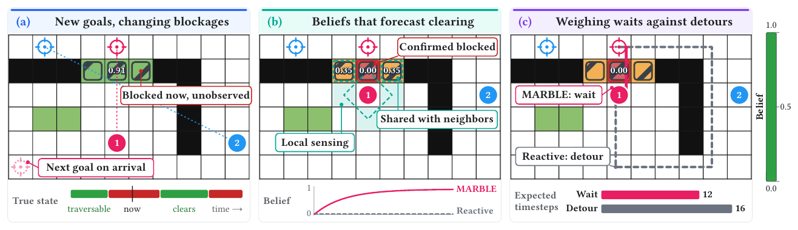

Multi-Agent Routing with Beliefs for Lifelong Execution (MARBLE) models each uncertain location's traversability as a two-state Markov chain. Noisy observations update the beliefs through Bayesian updates that account for sensor reliability, while successful and failed moves provide exact evidence. MARBLE estimates blocking and clearing rates online and shares information across nearby locations, then converts its forecasts into time-dependent planning costs for existing lifelong planners such as RHCR, PIBT, LaCAM, and LLLG.

<figure class="page__lead-media">
  
  <figcaption>(a) Agents receive new goals while passages become blocked and later clear. (b) MARBLE keeps a belief about each uncertain location, combining local sensing with information shared from nearby locations, and forecasts when a blocked passage will clear. (c) With that forecast, an agent can wait for a passage to reopen instead of taking a longer detour.</figcaption>
</figure>

With RHCR and 100 agents on five benchmark maps, MARBLE **improves throughput by 18% over reactive replanning** and 37% over a static Bayesian filter, and its advantage persists across four lifelong planners and teams of up to 1,000 agents.
